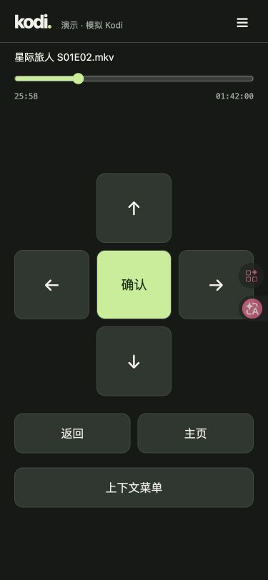
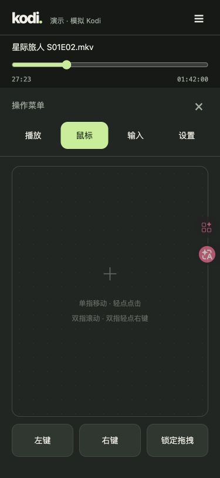
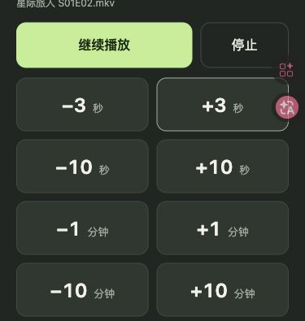
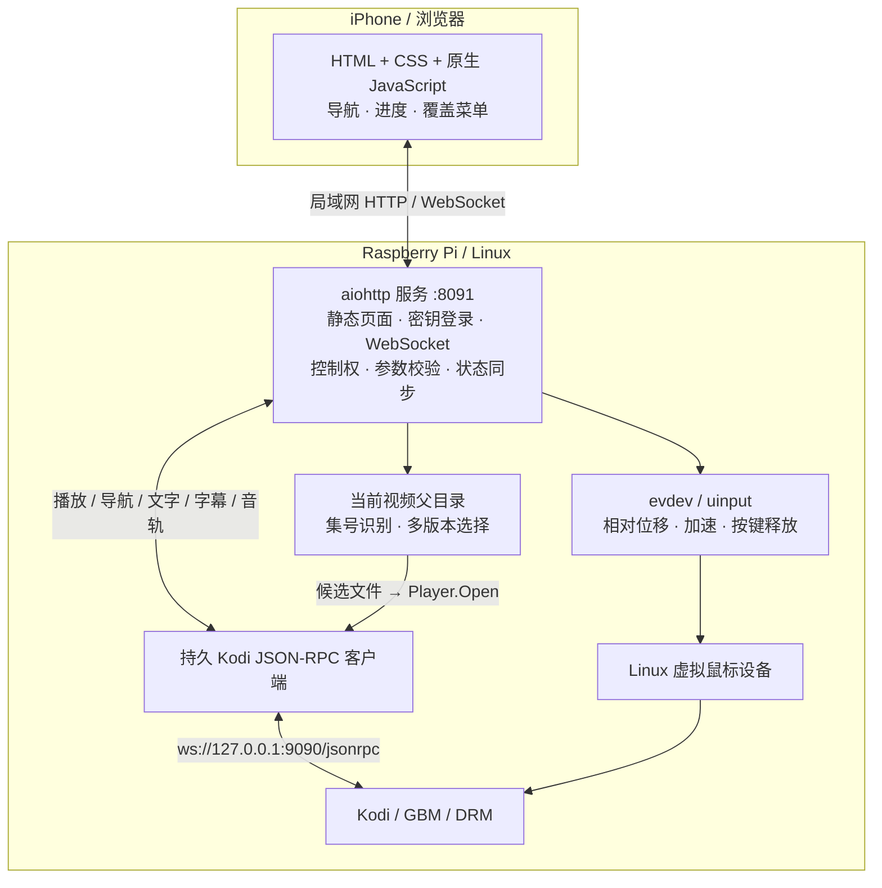

# Kodi Remote

用 iPhone 浏览器控制 Raspberry Pi 上的 Kodi：导航、鼠标、中文输入和播放器控制集中在一个局域网页面中，无需在手机安装 App。

主页面保留 Kodi 信息、播放进度和大尺寸导航键；鼠标、播放、输入与设置通过覆盖菜单打开。适合直接运行在 GBM/DRM 上、没有 X11 桌面的精简 Kodi 环境。

## 截图

| 主页面：导航与进度 | 鼠标菜单 | 播放菜单：含 ±3 秒 |
| --- | --- | --- |
|  |  |  |

截图来自浏览器演示模式，右侧粉色浮动图标属于测试浏览器扩展。播放菜单截图聚焦按钮区域。未播放时，主页面自动隐藏进度区。

## 功能

- **导航**：上、下、左、右、确认、返回、主页、上下文菜单。
- **播放**：播放/暂停、停止、前后 **3 秒 / 10 秒 / 1 分钟 / 10 分钟**。
- **进度**：48px 高触摸区域、28px 滑块；点击轨道或按住拖动，拖动时预览，松手只执行一次跳转；等待 Kodi 更新期间保持预览，避免旧状态拉回滑块。
- **鼠标**：相对位移、灵敏度调节、快速移动加速；单指轻点左键、双指轻点右键、双指滑动滚轮；支持拖拽锁定。
- **中文输入**：在手机输入法中完成选字，一次发送到 Kodi 标准文字输入对话框。
- **媒体选项**：软件音量、静音、字幕开关、字幕轨道、音轨。
- **本地上下集**：根据当前文件夹与集号识别上一集/下一集；缺集不自动跳过，多版本提供选择。
- **设备接管**：多设备可以连接查看状态，**同一时间只有一台设备能控制**；在菜单 → 设置中点击“接管控制”。

## 架构设计



### 为什么分为两条控制链路

播放器、导航和中文文本走 Kodi JSON-RPC，可以直接表达“后退 3 秒”或“输入整段中文”，无需依赖方向键的可变跳转步长，也不需要模拟中文键盘按键。

鼠标走 Linux uinput，向 Kodi 提供虚拟相对鼠标。速度相关的加速让慢划保持精度、快划跨越更远距离；小数位移会保留到后续事件中，减少低速移动丢失。该链路不依赖 X11 或 Wayland 桌面。

### 状态、控制权与断线处理

- 浏览器使用长连接发送指令，并接收播放器状态。服务端约每秒刷新状态，播放操作后触发刷新；页面在两次更新之间估算进度，暂停时停止计时。
- 第一个连接自动取得控制权。其他设备查看状态并可主动接管；接管时释放鼠标按键，取消原设备尚未发送的操作。
- 播放项目具有 `generation` 标识，旧视频的跳转请求不能误作用于新视频。
- 手机切后台、连接断开或心跳超时后释放鼠标。重连同步当前状态，**不自动重放历史操作**。
- 上下集仅枚举当前视频的直接父目录，并排除越界符号链接；浏览器不能指定任意文件路径。

### 部署与访问边界

服务由 systemd 管理，原生 Python 运行，无需 Docker、前端构建服务或 CDN。HTTP 页面仅面向可信家庭局域网，Kodi JSON-RPC 只监听 Pi 本机；不应将 8091 端口直接映射到公网。

访问密钥保存在 Pi 的 `/etc/kodi-remote.secret`，登录会话保存在服务内存中。重启遥控服务后，需要用原密钥重新登录；无需重启 Kodi。

### 代码结构

```text
kodi_remote/
├── server.py       # HTTP、鉴权、控制权、状态与操作分发
├── rpc.py          # 本机 Kodi JSON-RPC 长连接与请求响应
├── mouse.py        # uinput、灵敏度、速度加速、小数位移
├── episodes.py     # 本地文件夹与上下集识别
├── demo.py         # 不访问真实 Kodi 的演示后端
└── web/            # 无构建步骤的 HTML、CSS、JavaScript
scripts/
├── install.sh      # 当前 Pi 的安装与 systemd 配置
├── kodi-remote.service
└── smoke_pi.py     # 真实 Kodi / uinput 联调
```

## 使用方法

### 1. 在电脑上预览

需要 Python 3.10+。演示模式不连接真实 Kodi，也不会创建虚拟鼠标。

```sh
git clone git@github.com:MinweiShen/kodi-remote.git
cd kodi-remote
python3 -m venv .venv
. .venv/bin/activate
python -m pip install -r requirements.txt
python -m kodi_remote --demo
```

打开 <http://localhost:8091/>，访问密钥填写 **`demo`**。可测试导航、菜单、跳转、进度拖动、字幕与中文输入流程。主页面点“确认”会模拟打开 Kodi 搜索输入框。演示仅监听本机回环地址，不能从手机访问电脑的局域网地址。

### 2. 安装到 Raspberry Pi

已验证的实机环境：**Debian 13 ARM64、Python 3.13、Kodi 21.3（GBM/DRM）**。运行依赖为 `aiohttp` 与 Linux 上的 `evdev`。

当前安装脚本按用户 `pi` 和 `/home/pi` 布局编写，默认服务地址为 `192.168.0.114:8091`。其他设备需要先调整 `config.example.json` 的 `host`；使用其他用户名或目录时还需要修改安装脚本和 systemd 单元。

在 Pi 上检查现有服务和网络说明。安装脚本要求 `/home/pi/README.md` 与 `/home/pi/README-PROXY.md` 存在，并沿用当前 apt 网络配置；若是全新设备，应先准备适合自身环境的运维说明。

```sh
cat /home/pi/README.md /home/pi/README-PROXY.md
sudo apt-get update
sudo apt-get install -y git
mkdir -p /home/pi/src
cd /home/pi/src
git clone https://github.com/MinweiShen/kodi-remote.git
cd kodi-remote
# 如有必要，先调整 config.example.json 中的局域网地址
sudo bash scripts/install.sh
```

脚本安装 Python 系统依赖、配置 uinput 权限、复制运行文件、生成访问密钥并启用 `kodi-remote.service`。重复安装保留现有配置与密钥；已有配置的监听地址应修改 `/etc/kodi-remote.json`。不会停用已有的 8090 触控板服务。

然后在 Kodi 的 **设置 → 服务 → 控制** 中开启“允许本机应用程序远程控制”；必要时先切到高级/专家设置。保持“允许其他系统上的应用程序远程控制”关闭。服务默认连接 `ws://127.0.0.1:9090/jsonrpc`。

| 内容 | 默认位置 |
| --- | --- |
| 运行目录 | `/home/pi/apps/kodi-browser-remote` |
| 配置 | `/etc/kodi-remote.json` |
| 访问密钥 | `/etc/kodi-remote.secret`，权限 `root:pi 0640` |
| systemd 服务 | `kodi-remote.service` |
| 网页入口 | `http://<Pi 的局域网 IP>:8091/` |

### 3. iPhone 连接与操作

1. iPhone 与 Pi 连接同一局域网，Safari 打开 `http://<Pi 的局域网 IP>:8091/`。
2. 在 Pi 本机执行 `sudo cat /etc/kodi-remote.secret`，将密钥填入手机登录框。密钥不要提交到 Git、日志或公开 URL。
3. 主页面使用导航键操作 Kodi。播放视频后出现片名与进度条；可点击或拖动进度，松手跳转。
4. 打开右上角菜单，切换“播放 / 鼠标 / 输入 / 设置”。菜单覆盖导航区，便于点击大尺寸按钮。

| 场景 | 操作 |
| --- | --- |
| 前进/后退 3 秒 | 菜单 → 播放 → `−3 秒` / `+3 秒` |
| 其他固定跳转 | 同一菜单中的 ±10 秒、±1 分钟、±10 分钟 |
| 鼠标慢或不够灵敏 | 菜单 → 设置 → 提高灵敏度，按需开启快速滑动加速 |
| 中文搜索 | 先在 Kodi 打开标准搜索/文字对话框，再到菜单 → 输入，选字完成后发送 |
| 另一设备占用控制权 | 菜单 → 设置 → 接管控制；或关闭原设备页面后刷新 |
| 拖动文件/界面 | 菜单 → 鼠标 → 锁定拖拽，完成后释放；切换菜单页也会释放 |
| 本地视频上下集 | 菜单 → 播放 → 上一集 / 下一集；按当前文件夹的集号判断 |

当前重点支持本地视频。跳转精度受播放器、媒体格式和关键帧影响；音频直通时请通过电视或功放调音量。自定义插件的输入框不一定支持标准中文输入接口。

### 4. 更新与维护

在 Pi 的源码目录执行：

```sh
git pull --ff-only
sudo bash scripts/install.sh
systemctl status kodi-remote --no-pager
journalctl -u kodi-remote -n 50 --no-pager
```

安装脚本会重启遥控服务，手机需重新登录。仅重启服务可执行 `sudo systemctl restart kodi-remote`；Kodi 播放进程独立运行。

## 测试

```sh
python3 -m unittest discover -s tests -v
npm test
node --check kodi_remote/web/app.js
bash -n scripts/install.sh
```

Node 测试使用内置测试运行器，无需 `npm install`；需要支持 `node:test` 的 Node.js。当前验证结果为 **16 项 Python 测试、8 项 Node 测试通过**，包括 ±3 秒跳转、进度回弹、中文输入目标、跨设备接管、断线释放和上下集识别。

真实 Pi 已验证 uinput、Kodi 播放控制、字幕/音轨、中文对话框和进度拖动。iPhone Safari 的实际触感仍需在设备上验收。完整测试方法与回退步骤见 [TESTING.md](TESTING.md)，原始设计见 [设计文档](.scratch/kodi-browser-remote/spec.md)。

## 许可证

[MIT](LICENSE)
